<div align="center">
  
</div>

<!-- ━━━━━━━━━━━━━━━━━━━━━━━━━━━━━━━━━━━━━━━━━━━━━━━━━━━━━━━━━━━━━━━━━━━━━━━━ -->
<!-- SECTION 2 — SOCIAL CONNECTIONS -->
<!-- ━━━━━━━━━━━━━━━━━━━━━━━━━━━━━━━━━━━━━━━━━━━━━━━━━━━━━━━━━━━━━━━━━━━━━━━━ -->

<br/>

<div align="center">

  <a href="https://mafaz-portfolio-gold.vercel.app/" target="_blank">
    
  </a>
  &nbsp;&nbsp;
  <a href="https://www.linkedin.com/in/mohammed-mafaz-t-s-778602376/" target="_blank">
    
  </a>
  &nbsp;&nbsp;
  <a href="https://www.instagram.com/_mafaz__7/" target="_blank">
    
  </a>

</div>

<br/>

<div align="center">
  
</div>

<!-- ━━━━━━━━━━━━━━━━━━━━━━━━━━━━━━━━━━━━━━━━━━━━━━━━━━━━━━━━━━━━━━━━━━━━━━━━ -->
<!-- SECTION 3 — ABOUT ME -->
<!-- ━━━━━━━━━━━━━━━━━━━━━━━━━━━━━━━━━━━━━━━━━━━━━━━━━━━━━━━━━━━━━━━━━━━━━━━━ -->

<br/>

```python
class MohammedMafaz:
    """
    Backend Developer focused on building clean, scalable systems.
    AI-Assisted Full-Stack Builder. API Developer. Lifelong Learner.
    """

    primary_role   = "Backend Developer"
    stack          = ["Python", "Django", "Django REST Framework", "PostgreSQL", "MySQL", "MongoDB"]
    tools          = ["Git", "GitHub", "Docker"]
    ai_workflow    = ["ChatGPT", "Claude", "Gemini"]          # Tools I use to build smarter & faster
    capabilities   = ["REST API Development", "Database Design",
                       "AI-Assisted Full-Stack Development", "AI App Integration"]

    currently_learning = ["DRF Advanced Patterns", "Backend Architecture",
                           "Docker & Containerization", "DSA Fundamentals"]

    building       = True
    open_to_work   = True
    motto          = "Consistency turns code into capability."
```

<br/>

<div align="center">
  
</div>

<!-- ━━━━━━━━━━━━━━━━━━━━━━━━━━━━━━━━━━━━━━━━━━━━━━━━━━━━━━━━━━━━━━━━━━━━━━━━ -->
<!-- SECTION 4 — TECH STACK -->
<!-- ━━━━━━━━━━━━━━━━━━━━━━━━━━━━━━━━━━━━━━━━━━━━━━━━━━━━━━━━━━━━━━━━━━━━━━━━ -->

<br/>

<div align="center">

### `{ }` TECH STACK

</div>

<br/>

**`▸ BACKEND DEVELOPMENT`** &nbsp;— *Primary*

<div align="center">
  
  &nbsp;
  
</div>

<br/>

**`▸ DATABASES`**

<div align="center">
  
  &nbsp;
  
</div>

<br/>

**`▸ DEVELOPMENT TOOLS`**

<div align="center">
  
</div>

<br/>

**`▸ FRONTEND BASICS`** &nbsp;— *AI-Assisted*

<div align="center">
  
</div>

<br/>

**`▸ AI DEVELOPMENT TOOLS`** &nbsp;— *Workflow & Integration*

<div align="center">
  
  &nbsp;
  
  &nbsp;
  
</div>

<br/>

<div align="center">


  
</div>

<!-- ━━━━━━━━━━━━━━━━━━━━━━━━━━━━━━━━━━━━━━━━━━━━━━━━━━━━━━━━━━━━━━━━━━━━━━━━ -->
<!-- SECTION 5 — AI-ASSISTED DEVELOPMENT WORKFLOW -->
<!-- ━━━━━━━━━━━━━━━━━━━━━━━━━━━━━━━━━━━━━━━━━━━━━━━━━━━━━━━━━━━━━━━━━━━━━━━━ -->

<br/>

<div align="center">

### `✦ AI-ASSISTED FULL-STACK WORKFLOW`

</div>

<div align="center">
  
</div>

> My backend expertise forms the core of every project. I leverage AI development tools to accelerate frontend development, integrate AI-powered features, and ship complete applications — without losing my backend-first foundation.

<br/>

<div align="center">
  
</div>

<!-- ━━━━━━━━━━━━━━━━━━━━━━━━━━━━━━━━━━━━━━━━━━━━━━━━━━━━━━━━━━━━━━━━━━━━━━━━ -->
<!-- SECTION 6 — GITHUB ANALYTICS -->
<!-- ━━━━━━━━━━━━━━━━━━━━━━━━━━━━━━━━━━━━━━━━━━━━━━━━━━━━━━━━━━━━━━━━━━━━━━━━ -->

<br/>

<div align="center">

### `◈ GITHUB ANALYTICS`

</div>

<div align="center">

  


</p>

---

# 🔥 GitHub Streak

<p align="center">
  
</p>


---

# 📈 Contribution Graph

<p align="center">

</p>

---

# 📋 Profile Summary

<p align="center">

</p>

---

# 📚 Languages & Commit Statistics

<p align="center">


</p>

---

# ⏰ Productive Time

<p align="center">

</p>

---

<h3 align="center">
Code. Build. Deploy. Repeat. 🚀
</h3>
