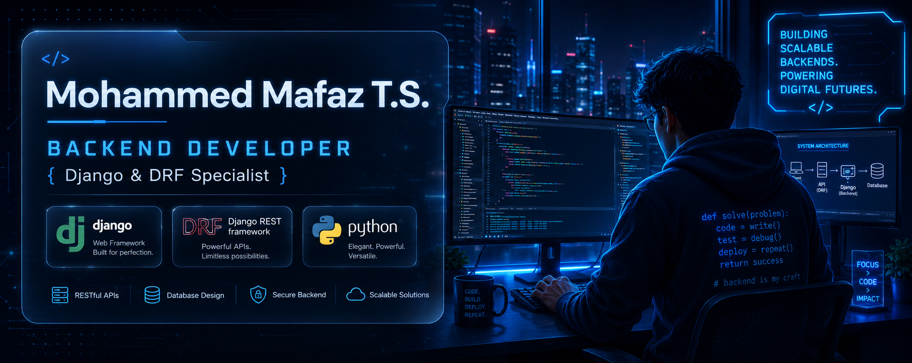
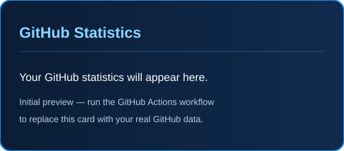
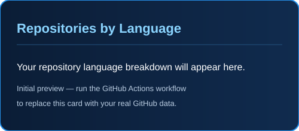
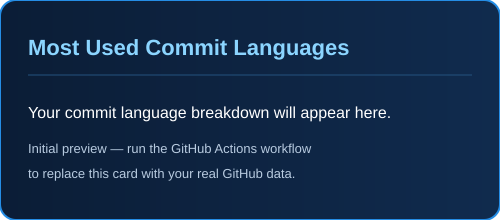
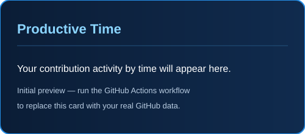
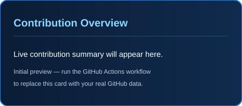

<div align="center">

  

  <br/>

  

  <h3>🚀 Backend Developer | Python | Django | Django REST Framework</h3>
  <p>🎓 Final-Year BCA Student &nbsp;•&nbsp; 🇮🇳 India &nbsp;•&nbsp; 💻 Python Developer</p>

  <a href="https://github.com/MAFAZ9416"></a>
  <a href="https://www.linkedin.com/in/mohammed-mafaz-t-s-778602376/"></a>
  <a href="https://mafaz-portfolio-gold.vercel.app/"></a>

  <br/><br/>
  
</div>

---

## 👨‍💻 About Me

Hey! I'm **Mohammed Mafaz T.S.**, a final-year BCA student passionate about backend development and building useful software applications.

I mainly work with Python, Django and Django REST Framework. I enjoy designing APIs, managing databases and developing backend systems.

- 🔭 Building backend applications using Django and DRF.
- 🌱 Exploring Docker, System Design and backend architecture.
- 💡 Interested in REST APIs, authentication and database design.
- 🛠️ Working with PostgreSQL, MySQL, Git and GitHub.
- 🎯 Goal: Become a skilled Backend Engineer.
- ⚡ Motto: Build. Learn. Improve. Repeat.

---

## 🧑‍💻 Developer Snapshot

```python
class MohammedMafaz:
    name = "Mohammed Mafaz T.S."
    role = "Backend Developer"
    education = "BCA"

    languages = ["Python", "SQL"]
    frameworks = ["Django", "Django REST Framework"]
    databases = ["PostgreSQL", "MySQL", "SQLite"]
    tools = ["Git", "GitHub", "Postman", "Docker"]

    interests = [
        "Backend Development",
        "REST API Development",
        "Database Design",
        "System Design",
    ]

    currently_learning = ["Docker", "System Design"]
    goal = "Backend Engineer"
    motto = "Code. Build. Deploy. Repeat."
```

---

## ⚒️ Tech Stack & Tools

<div align="center">

**Programming Language**


**Backend Development**


**Databases**


**Tools & Development Environment**


**Data Analysis**


</div>

---

## 🚀 Featured Projects

### 🛒 TechHub — E-Commerce API
A backend API for an e-commerce platform.
- Django REST Framework
- JWT Authentication
- PostgreSQL
- Product and order management

### 🤖 AI Chat Backend
An AI-powered conversational backend.
- Gemini API integration
- Chat history management
- Token tracking
- REST API development

### 📊 Student Dashboard
A dashboard application for managing student information and activities.
- Django REST Framework
- JWT Authentication
- Role management
- Analytics dashboard

### 📝 Blog Platform
A backend application for creating and managing blog posts.
- Django
- Authentication system
- CRUD operations
- Database management

---

## 📊 GitHub Analytics

<div align="center">

  
  

  <br/><br/>

  
  

</div>

---

## 📈 Contribution Overview

<div align="center">
  
</div>

---

## 🐍 Contribution Snake

<div align="center">
  <picture>
    <source media="(prefers-color-scheme: dark)" srcset="https://raw.githubusercontent.com/MAFAZ9416/MAFAZ9416/output/github-contribution-grid-snake-dark.svg"/>
    <source media="(prefers-color-scheme: light)" srcset="https://raw.githubusercontent.com/MAFAZ9416/MAFAZ9416/output/github-contribution-grid-snake.svg"/>
    
  </picture>
</div>

---

## 🏆 GitHub Achievements

Explore my actual GitHub activity, repositories and achievements:

<div align="center">
  <a href="https://github.com/MAFAZ9416?tab=achievements">
    
  </a>
</div>

---

## 📚 Currently Learning

| Technology | Focus |
|:---|:---|
| Django REST Framework | Advanced API development |
| Docker | Containerization |
| PostgreSQL | Database optimization |
| System Design | Scalable backend architecture |
| Python | Problem solving and DSA |

---

## 🤝 Let's Connect

<div align="center">
  <a href="https://github.com/MAFAZ9416"></a>
  <a href="https://www.linkedin.com/in/mohammed-mafaz-t-s-778602376/"></a>
  <a href="https://mafaz-portfolio-gold.vercel.app/"></a>

  <br/><br/>
  **"Great software is built one problem at a time."**
  <br/><br/>
  
</div>
